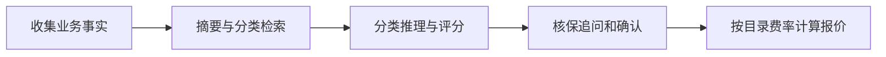

# Contextual Quoting Agentic System

基于 LangGraph 的上下文报价教学项目，可直接在 PyCharm 中运行。主模型为 DeepSeek，千问负责备用对话和向量嵌入，分类检索使用 Chroma。业务确认与金额计算分开，费率只从分类目录读取。

改编自 **Nir Diamant** 的 [GenAI_Agents](https://github.com/NirDiamant/GenAI_Agents)。本项目进行了模块化重建、供应商兼容性修复和项目精简，沿用原仓库的自定义非商业许可证，见 [LICENSE](LICENSE)。

## 开始使用

1. 在 PyCharm 打开 `E:\contextual_quoting_agentic_system`。
2. 选择已有解释器 `E:\contextual_quoting_agentic_system\.venv\Scripts\python.exe`。
3. 运行根目录的 `main.py`，或选择 `Contextual Quoting` 运行配置。也可双击 `run.bat`。
4. **输入后直接按回车发送。** `/new` 开始新会话，`/exit` 退出。

本地 `.env` 已保留模型配置。首次在其他机器使用时，将 `.env.example` 复制为 `.env` 并填写自己的密钥。DeepSeek 可选；千问密钥用于嵌入，也可以承担全部对话。系统环境变量优先于 `.env`，追踪默认关闭。

普通输入每次回车发送一条消息。快速粘贴的多行内容会自动合并，空行不调用模型，也不会反复打印“你：”。程序使用约 80 毫秒的输入空闲间隔识别同次粘贴；如果终端分批送入的间隔超过该值，会按多条消息处理。没有发送命令或输入模式切换。

助手回复后出现的下一个“你：”表示等待新消息。每轮只展示最终有效回复；工具过程和完整消息仍保存在当前会话状态中。

## 独立环境

Python 3.13.13 基础运行时位于本项目 `.python-runtime/`，依赖环境位于 `.venv/`，不共享其他项目的包。已有环境可以直接使用。

重新安装时需要 [uv](https://docs.astral.sh/uv/getting-started/installation/)，然后执行：

```powershell
cd E:\contextual_quoting_agentic_system
powershell -NoProfile -ExecutionPolicy Bypass -File .\setup.ps1
.\.venv\Scripts\python.exe main.py
```

安装脚本按 `.python-version` 下载独立 Python，并按 `uv.lock` 安装依赖，不调用模型。依赖只在 `pyproject.toml` 定义，锁定版本只由 `uv.lock` 管理。重复执行安装脚本会同步已有环境。迁移到另一台机器或改变项目路径后，请重新创建环境。

## 常用命令

```powershell
.\.venv\Scripts\python.exe main.py check     # 配置和目录检查，不调用模型
.\.venv\Scripts\python.exe main.py demo      # 离线计算 4,000,000 × 1.97 / 1000
.\.venv\Scripts\python.exe main.py index --verbose
.\.venv\Scripts\python.exe -m unittest discover -s tests -v
.\.venv\Scripts\python.exe scripts\smoke_test.py
```

`index` 会准备或复用分类向量。`smoke_test.py` 是可选的真实接口检查，会调用模型服务；离线测试不需要密钥或网络。可以用 `--env-file "其他目录\.env"` 指定另一份配置。`python -m quoting_agent` 也使用同一入口。

## 流程和文件职责



| 文件 | 职责 |
| --- | --- |
| `main.py` / `quoting_agent/__main__.py` | PyCharm 脚本入口和 Python 模块入口，均调用同一个 CLI |
| `quoting_agent/cli.py` | 命令行、回车发送、粘贴合并、交互输出 |
| `quoting_agent/app.py` | 唯一应用组装入口、会话隔离和异常恢复 |
| `quoting_agent/workflow.py` | LangGraph 状态、节点、工具执行和路由 |
| `quoting_agent/models.py` | 业务字段、工具参数和结构化输出校验 |
| `quoting_agent/prompts.py` | 主助手、核保、报价和分类模型的提示词 |
| `quoting_agent/llm.py` | DeepSeek/千问模型绑定及原生自动降级 |
| `quoting_agent/catalog.py` | 分类数据读取、类别/代码/描述身份核对、费率提取 |
| `quoting_agent/retrieval.py` | 千问嵌入、Chroma 持久化和检索 |
| `quoting_agent/pricing.py` | Decimal 金额计算与最终报价格式化 |
| `data/cat_codes_descriptions.csv` | 分类和费率的唯一数据源 |
| `pyproject.toml` / `uv.lock` | 项目配置和依赖锁定 |
| `setup.ps1` / `run.bat` | 环境安装和便捷启动 |
| `tests/` / `scripts/smoke_test.py` | 离线行为测试和可选真实接口验证 |
| `docs/PROJECT_REVIEW.md` | 本次完整检查、删并理由和验证范围 |

`runtime/chroma/` 是在用的向量缓存；更换分类内容、嵌入模型或接口地址会使用新的集合。`runtime/live_validation.json` 由真实接口检查生成。对话检查点只存在当前进程内，退出后不会恢复；用 `/new` 可立即隔离另一家企业。

## 数据与计算规则

原始 `.csv` 实际为逐行标签文本。439 条原始记录中，第 182 行的 Process Servers 缺少代码，程序保留原文件并跳过该行，使用 438 条有效记录；`check` 显示数量，`--verbose` 显示诊断。多个描述可能共用代码，因此必须使用“类别＋代码＋描述”核对分类。

13 个类别的费率直接从目录提取，不再复制到独立的 SQLite 费率数据库。多个分类同属一类时先去重；预计营收在不同类别间平均分配，余下美分补齐，逐项保费四舍五入后求和。未知类别、非正数或非有限营收会被拒绝。模型传入的类别和营收必须符合已确认状态。

原例中，CONSULTANTS 费率为每 1,000 USD 收取 1.97 USD，400 万美元营收对应 7,880 USD。面包店例中，若全部已确认分类同属 RESTAURANTS/MOBILE FOOD SERVICES，费率 2.85 对应 50 万美元营收的 1,425 USD。这些是教程费率与计算规则；实际业务需要另行提供真实费率和收入分配规则。

旧版 LangGraph 在当前依赖组合下仍可能输出一条序列化默认值弃用提示；离线计算和帮助命令现在不加载工作流，不再触发该提示。此轮没有为消除提示而更换工作流框架。
